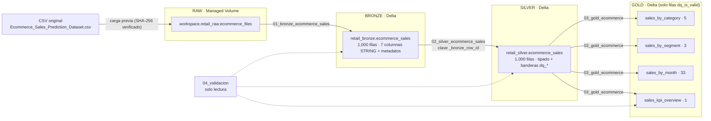

# Cierre v1.0 — Laboratorio Medallion en Databricks Free Edition

Documento de cierre del laboratorio. Cada resultado de este documento procede de (a) la ejecución en Databricks y consultas SQL
de solo lectura, (b) los notebooks de `lakehouse_lab/notebooks/` o (c) el dictamen independiente indicado en la
sección 10. No se incluyen capturas: no se archivaron; la evidencia son las consultas reproducibles de la sección 9.

## 1. Objetivo y alcance

**Objetivo.** Demostrar una arquitectura Medallion (RAW → Bronze → Silver → Gold) funcional sobre Databricks Free Edition con
Unity Catalog y cómputo serverless, usando el dataset *Ecommerce Sales Prediction* (1000 filas, 7 columnas).

**Dentro del alcance:** ingesta del CSV desde un Managed Volume, persistencia Delta, tipado y controles de calidad con trazabilidad,
cuatro tablas analíticas Gold, validación y documentación.

**Fuera del alcance:** S3, External Locations, Storage Credentials, Managed Identity, orquestación productiva (bundle/CI-CD),
reprocesamiento, dashboards sobre estas tablas y cálculo de ventas netas.

> **RAW es un Managed Volume, no S3.** Esta implementación **no demuestra integración con S3, External Locations ni Managed
> Identity** ni el cumplimiento de ese requisito. La arquitectura original con S3 (`databricks.yml`, `proceso/`) es independiente,
> no se usó ni se modificó.

## 2. Arquitectura Medallion

Entorno: Databricks Free Edition, catálogo `workspace`, serverless, perfil CLI local `RETAIL_FREE`. Tres esquemas por capa
(`retail_bronze`, `retail_silver`, `retail_gold`) más `retail_raw` para el Volume. Todas las tablas son Delta gestionadas (MANAGED).

## 3. Diagrama de flujo



Orden de ejecución: `00_setup_schemas` → `01` → `02` → `03` → `04`, como run serverless de cinco tareas encadenadas.

## 4. Capas

| Capa | Contenido | Notebook |
|---|---|---|
| RAW | CSV original sin modificar en el Volume. Su SHA-256 coincide con el del archivo local (`db6b4ebe…d7162`). | — (carga previa) |
| Bronze | Lectura sin inferir tipos (`FAILFAST`), 7 columnas originales como STRING, más `_source_file`, `_source_file_modified_at`, `_ingested_at`, `_bronze_row_id`. | `01_bronze_ecommerce_sales` |
| Silver | Conversión con `try_to_date`/`try_cast`; vacíos → NULL; banderas de calidad; no se descarta ninguna fila. | `02_silver_ecommerce_sales` |
| Gold | Agregaciones sobre filas con `dq_is_valid = true` y reconciliación contra Silver. | `03_gold_ecommerce` |

## 5. Tablas y esquemas

**Bronze** `workspace.retail_bronze.ecommerce_sales`: `Date`, `Product_Category`, `Price`, `Discount`, `Customer_Segment`,
`Marketing_Spend`, `Units_Sold` (todas STRING); `_source_file` STRING; `_source_file_modified_at` TIMESTAMP; `_ingested_at` TIMESTAMP;
`_bronze_row_id` LONG.

**Silver** `workspace.retail_silver.ecommerce_sales`: `_bronze_row_id` LONG; `sale_date` DATE; `product_category`, `customer_segment`
STRING; `price`, `discount_value`, `marketing_spend` DOUBLE; `units_sold` INT; `dq_null_field`, `dq_conversion_failed`,
`dq_duplicate`, `dq_range_violation`, `dq_is_valid` BOOLEAN; `_source_file` STRING; `_ingested_at`, `_silver_processed_at` TIMESTAMP.

**Gold** (`workspace.retail_gold.*`): métricas comunes `records`, `units_sold_total`, `avg_units_per_record`, `avg_price`,
`avg_discount_value`, `marketing_spend_total`, `avg_marketing_spend`, `list_price_revenue`, `marketing_spend_per_unit`,
`_gold_processed_at`; clave `product_category`, `customer_segment` o `year_month`; `sales_kpi_overview` añade `date_min`, `date_max`.
(Los tipos Gold no se listaron en la verificación SQL de esta sección; se consultan con la query 3 de la sección 9.)

## 6. Resultados físicos

| Tabla | Filas |
|---|---:|
| `retail_bronze.ecommerce_sales` | 1,000 |
| `retail_silver.ecommerce_sales` | 1,000 |
| `retail_gold.sales_by_category` | 5 |
| `retail_gold.sales_by_segment` | 3 |
| `retail_gold.sales_by_month` | 33 |
| `retail_gold.sales_kpi_overview` | 1 |

Las seis tablas figuran como `MANAGED` / `DELTA` en `workspace.information_schema.tables`.

## 7. Métricas y reconciliación

Fórmulas (sobre filas válidas de Silver): `records` = COUNT(\*); `units_sold_total` = SUM(units_sold); `avg_price` = AVG(price)
(media simple por registro, **no ponderada**); `marketing_spend_total` = SUM(marketing_spend); `list_price_revenue` =
SUM(price × units_sold) (**ingreso bruto a precio de lista; no es venta neta**); `marketing_spend_per_unit` =
marketing_spend_total / units_sold_total.

| Métrica (`sales_kpi_overview`) | Valor |
|---|---:|
| Registros representados | 1,000 |
| Unidades vendidas | 29,631 |
| Ingreso bruto a precio de lista | 15,002,484.56 |
| Precio medio | 505.2419 |
| Gasto total en marketing | 4,912,830.24 |
| Rango de fechas | 2023-01-01 – 2025-09-26 |

Reconciliación entre capas:

- Filas físicas: RAW 1,000 = Bronze 1,000 = Silver 1,000. Gold son cuatro tablas con 5, 3, 33 y 1 filas físicas.
- Registros representados: la suma de la columna `records` en `sales_by_category`, `sales_by_segment`, `sales_by_month` y
  `sales_kpi_overview` es 1,000 en cada una (no son 1,000 filas físicas).
- 0 filas de Bronze sin correspondencia en Silver (anti-join por `_bronze_row_id`).

**Qué comprueba cada mecanismo.** Se distinguen cuatro niveles; no deben confundirse:

1. **Aserciones contenidas en los notebooks** (todas terminaron sin error en la ejecución histórica):
   - `01_bronze_ecommerce_sales`: columnas leídas = las 7 originales; filas RAW = Bronze = 1000; columnas de datos Bronze en STRING; `_bronze_row_id` único.
   - `02_silver_ecommerce_sales`: existe Bronze; filas Bronze = filas Silver; 0 filas de Bronze sin correspondencia en Silver (por `_bronze_row_id`). Los conteos de banderas `dq_*` se muestran, no se afirman.
   - `03_gold_ecommerce`: para `sales_by_category`, `sales_by_segment` y `sales_by_month`, la suma de `records`, de `units_sold_total` y de `marketing_spend_total` (redondeada a 2 decimales) coincide con el recuento, las unidades y el marketing de Silver válido. **`sales_kpi_overview` no está incluida en esa comprobación.**
   - `04_validacion`: RAW = Bronze = Silver en filas; 0 filas Bronze sin correspondencia en Silver; en `sales_kpi_overview`, `records` y `units_sold_total` coinciden con Silver válido. **No comprueba el marketing del KPI** ni las tablas Gold de categoría, segmento y mes.
2. **Consultas SQL independientes** (sección 9): suman evidencia, pero no son aserciones de los notebooks. Las consultas 7 a 12, ejecutadas en la auditoría independiente del 2026-11-13, reconcilian registros, unidades y `list_price_revenue` (consulta 10) también para el KPI.
3. **Evidencia histórica de ejecución:** el run original con las 5 tareas en `SUCCESS` y las consultas 1 a 6 de la sesión de implementación.
4. **Lo que permanece sin comprobación específica:** el `marketing_spend_total` del KPI Gold frente a Silver no está cubierto por ninguna aserción de los notebooks ni por las consultas 7 a 12 (su valor figura en la consulta 6). Tampoco hay aserciones sobre `avg_price` ni sobre las demás métricas derivadas.

## 8. Reglas de calidad (Silver)

| Regla | Definición | Resultado |
|---|---|---:|
| `dq_null_field` | algún campo original nulo o vacío | 0 |
| `dq_conversion_failed` | campo no vacío que no convierte a fecha/número | 0 |
| `dq_duplicate` | repetición de los 7 campos originales (la primera ocurrencia no se marca) | 0 |
| `dq_range_violation` | `price<=0`, `discount_value<0`, `marketing_spend<0` o `units_sold<0` | 0 |
| `dq_is_valid` | ninguna bandera anterior | 1,000 de 1,000 |

La fecha se interpreta como `dd-MM-yyyy` (el dataset contiene valores como `24-09-2025`, con día > 12). Las reglas marcan, no
eliminan.

## 9. Evidencias de ejecución y consultas reproducibles

**Ejecución.** Run serverless `retail_lakehouse_lab_medallion` con cinco tareas (`00_setup_schemas`, `01_bronze_ecommerce_sales`,
`02_silver_ecommerce_sales`, `03_gold_ecommerce`, `04_validacion`), todas en `SUCCESS`. Un relanzamiento posterior de Bronze falló
por diseño (la tabla ya existía) y dejó la tabla intacta con 1,000 filas. La salida impresa de los notebooks no se capturó en el run;
por eso los resultados se contrastaron con las consultas siguientes.

Todas las consultas son de solo lectura (`SELECT`). Estado de cada una:

- **Ejecutadas históricamente (1, 2, 4, 5, 6):** se ejecutaron por SQL Warehouse en la sesión de implementación con resultados
  coincidentes con este documento. El texto de abajo está ligeramente reformateado (alias, etiquetas), por lo que **no se ha
  reejecutado literalmente**.
- **Consulta 3 (esquemas):** se ejecutó solo para Bronze y Silver; aquí se amplía a Gold y **esa ampliación no se ha ejecutado**.
- **Consultas 7 a 12:** ejecutadas el **13 de noviembre de 2026** durante la auditoría independiente de cierre (ver más abajo).
  Esa validación es distinta de la ejecución histórica original del pipeline: no reejecutó el pipeline ni escribió datos.

```sql
-- 1. Tablas y formato
SELECT table_schema, table_name, table_type, data_source_format
FROM workspace.information_schema.tables WHERE table_schema LIKE 'retail_%' ORDER BY 1, 2;

-- 2. Conteos y reconciliación
SELECT 'bronze' AS capa, count(*) AS n FROM workspace.retail_bronze.ecommerce_sales
UNION ALL SELECT 'silver', count(*) FROM workspace.retail_silver.ecommerce_sales
UNION ALL SELECT 'gold_category', sum(records) FROM workspace.retail_gold.sales_by_category
UNION ALL SELECT 'gold_segment', sum(records) FROM workspace.retail_gold.sales_by_segment
UNION ALL SELECT 'gold_month', sum(records) FROM workspace.retail_gold.sales_by_month
UNION ALL SELECT 'gold_kpi', sum(records) FROM workspace.retail_gold.sales_kpi_overview;

-- 3. Esquemas
SELECT table_schema, table_name, column_name, data_type
FROM workspace.information_schema.columns WHERE table_schema LIKE 'retail_%'
ORDER BY table_schema, table_name, ordinal_position;

-- 4. Controles de calidad
SELECT count(*) filas, sum(int(dq_null_field)) nulos, sum(int(dq_conversion_failed)) conversion,
       sum(int(dq_duplicate)) duplicados, sum(int(dq_range_violation)) rango, sum(int(dq_is_valid)) validas,
       min(sale_date) fecha_min, max(sale_date) fecha_max
FROM workspace.retail_silver.ecommerce_sales;

-- 5. Trazabilidad Bronze -> Silver (esperado: 0)
SELECT count(*) AS sin_correspondencia
FROM workspace.retail_bronze.ecommerce_sales b ANTI JOIN workspace.retail_silver.ecommerce_sales s
  ON b._bronze_row_id = s._bronze_row_id;

-- 6. KPI Gold
SELECT * EXCEPT (_gold_processed_at) FROM workspace.retail_gold.sales_kpi_overview;

-- 7. Filas RAW desde el Managed Volume (esperado: 1000)
SELECT count(*) AS filas_raw
FROM read_files('/Volumes/workspace/retail_raw/ecommerce_files/Ecommerce_Sales_Prediction_Dataset.csv',
                format => 'csv', header => true);

-- 8. Filas físicas de cada tabla Gold (esperado: 5, 3, 33, 1)
SELECT 'sales_by_category' AS tabla, count(*) AS filas FROM workspace.retail_gold.sales_by_category
UNION ALL SELECT 'sales_by_segment', count(*) FROM workspace.retail_gold.sales_by_segment
UNION ALL SELECT 'sales_by_month', count(*) FROM workspace.retail_gold.sales_by_month
UNION ALL SELECT 'sales_kpi_overview', count(*) FROM workspace.retail_gold.sales_kpi_overview;

-- 9. Unidades vendidas: Silver válido vs. cada Gold (esperado: 29631 en todas)
SELECT 'silver_valido' AS origen, sum(units_sold) AS unidades
FROM workspace.retail_silver.ecommerce_sales WHERE dq_is_valid
UNION ALL SELECT 'gold_category', sum(units_sold_total) FROM workspace.retail_gold.sales_by_category
UNION ALL SELECT 'gold_segment', sum(units_sold_total) FROM workspace.retail_gold.sales_by_segment
UNION ALL SELECT 'gold_month', sum(units_sold_total) FROM workspace.retail_gold.sales_by_month
UNION ALL SELECT 'gold_kpi', sum(units_sold_total) FROM workspace.retail_gold.sales_kpi_overview;

-- 10. Ingreso bruto a precio de lista: Silver válido vs. KPI Gold
-- (Gold redondea a 2 decimales: comparar con tolerancia, esperado ~15002484.56; no es venta neta)
SELECT (SELECT round(sum(price * units_sold), 2) FROM workspace.retail_silver.ecommerce_sales WHERE dq_is_valid) AS silver_list_price_revenue,
       (SELECT sum(list_price_revenue) FROM workspace.retail_gold.sales_kpi_overview) AS gold_list_price_revenue;

-- 11. Meses de la tabla mensual (esperado: 33 filas y 33 meses distintos)
SELECT count(*) AS filas, count(DISTINCT year_month) AS meses_distintos,
       min(year_month) AS primero, max(year_month) AS ultimo
FROM workspace.retail_gold.sales_by_month;

-- 12. Registros representados por tabla Gold (esperado: 1000 en cada una)
SELECT 'sales_by_category' AS tabla, sum(records) AS registros FROM workspace.retail_gold.sales_by_category
UNION ALL SELECT 'sales_by_segment', sum(records) FROM workspace.retail_gold.sales_by_segment
UNION ALL SELECT 'sales_by_month', sum(records) FROM workspace.retail_gold.sales_by_month
UNION ALL SELECT 'sales_kpi_overview', sum(records) FROM workspace.retail_gold.sales_kpi_overview;
```

### Validación de las consultas 7 a 12 (auditoría independiente, 2026-11-13)

La auditoría independiente de cierre (Codex) ejecutó las consultas 7 a 12 el 13 de noviembre de 2026 con el perfil `RETAIL_FREE`
y el warehouse existente *Serverless Starter Warehouse*. Fueron exclusivamente `SELECT` (solo lectura), todas terminaron en
`SUCCEEDED` y no hubo errores SQL ni diferencias numéricas. **Esto no es una reejecución del pipeline**: las tablas son las
creadas en la ejecución histórica original y no se modificaron. Los resultados los reporta la auditoría; no se han archivado
capturas ni salidas en el repositorio. Las consultas 1 a 6 conservan su estado anterior y no se atribuyen a esta auditoría.

| Consulta | Resultado |
|---|---|
| 7. Filas RAW | 1,000 |
| 8. Filas físicas Gold | 5 (`sales_by_category`), 3 (`sales_by_segment`), 33 (`sales_by_month`), 1 (`sales_kpi_overview`) |
| 9. Unidades vendidas | 29,631 en Silver válido y en las cuatro tablas Gold |
| 10. Ingreso bruto a precio de lista | 15,002,484.56 en Silver y en el KPI Gold (bruto, no venta neta) |
| 11. Meses de la tabla mensual | 33, de 2023-01 a 2025-09 |
| 12. Registros representados (`SUM(records)`) | 1,000 en cada agregación |

Distinción: los 5, 3, 33 y 1 son **filas físicas** de cada tabla Gold; los 1,000 de la consulta 12 son **registros de origen
representados** por la suma de `records`, no filas físicas.

## 10. Dictamen independiente

Auditoría independiente realizada con Codex: **PASS WITH OBSERVATIONS**. El informe de auditoría no está en este repositorio; las observaciones listadas abajo son las recogidas en el encargo de cierre y se reflejan en las secciones 11 y 12.

1. Los controles de calidad tienen validación positiva, pero faltan pruebas negativas suficientes.
2. Las reglas de rango y dominio tienen cobertura limitada.
3. `Discount` no tiene unidad confirmada y no debe usarse para ventas netas.
4. La protección contra sobrescritura impide una segunda ejecución normal si las tablas existen.
5. No existe un procedimiento de reprocesamiento reproducible.
6. Los supuestos sobre `Price` y la granularidad del registro son hipótesis.
7. `scripts/validar_repo.py` pasó, pero no valida directamente el laboratorio.

## 11. Limitaciones técnicas

- **RAW en Managed Volume; sin S3, External Locations ni Managed Identity.** No sustituye a la arquitectura original con S3.
- **Calidad sin pruebas negativas.** Con datos limpios todas las banderas salen a 0: el flujo positivo está validado, pero no se ha
  probado que las reglas detecten nulos, duplicados, fechas inválidas o valores fuera de rango.
- **Rango y dominio limitados.** Solo se comprueban signos; no hay límites superiores ni catálogo de valores permitidos para
  categoría o segmento.
- **`Discount` sin unidad confirmada** (observado 0.01–49.92, compatible con porcentaje o importe). Solo se tipa como `discount_value`;
  no hay ventas netas. `list_price_revenue` es bruto a precio de lista.
- **Hipótesis, no hechos:** `Price` es precio unitario; cada fila es un registro diario (hay una fila por fecha en 2023-01-01…2025-09-26).
  `avg_price` es media simple, no ponderada por unidades.
- **Sin re-ejecución normal.** Si una tabla existe, el notebook falla sin reemplazarla (decisión de seguridad del laboratorio).
- **Sin procedimiento de reprocesamiento.** Las tablas existentes están protegidas contra sobrescritura y recrearlas exigiría una
  decisión manual, pero todavía no existe un procedimiento integral documentado, probado y reproducible. Además,
  `_bronze_row_id` usa `monotonically_increasing_id()`, que no es determinista entre cargas: una recarga de Bronze cambiaría las claves.
- **Cobertura de validación acotada.** Las aserciones de los notebooks y las consultas SQL cubren los conteos, la trazabilidad y las sumas indicadas en la sección 7; no hay pruebas automatizadas independientes de los notebooks ni se valida cada métrica Gold.
- **Validación del repositorio no específica.** `scripts/validar_repo.py` terminó sin errores, pero no valida directamente `lakehouse_lab/`. No
  existen pruebas automatizadas específicas del laboratorio; ninguna otra prueba del repositorio se presenta como cobertura del Medallion.
- **Operación manual.** Notebooks importados con la CLI y ejecutados con `jobs submit`; no hay bundle, planificación ni CI para el laboratorio.
- **Free Edition:** un único workspace, solo serverless, cuotas limitadas, sin separación dev/prod física.
- **Evidencia sin capturas** y salida de notebooks no capturada en el run (ver sección 9).

## 12. Posibles mejoras (versión posterior)

1. Pruebas negativas automatizadas con un conjunto sintético defectuoso (nulos, duplicados, fechas inválidas, negativos), ejecutadas
   sin tocar las tablas del laboratorio.
2. Reglas de dominio y rango superior (catálogo de categorías/segmentos, límites de precio y unidades).
3. Confirmar la unidad de `Discount` con la fuente; solo entonces definir ventas netas.
4. Diseñar y probar un procedimiento de reprocesamiento (hoy inexistente): carga idempotente (p. ej. `MERGE` por clave natural) o procedimiento controlado de recreación, y
   clave de fila determinista.
5. Empaquetado como Asset Bundle para este workspace, con job y tests del laboratorio en CI.
6. Capturar la salida de los notebooks (o registrar métricas en una tabla de auditoría) como evidencia persistente.
7. Dashboard sobre las tablas Gold.
8. Si se persigue el requisito original: una versión con External Location y credencial de almacenamiento, documentada aparte.
